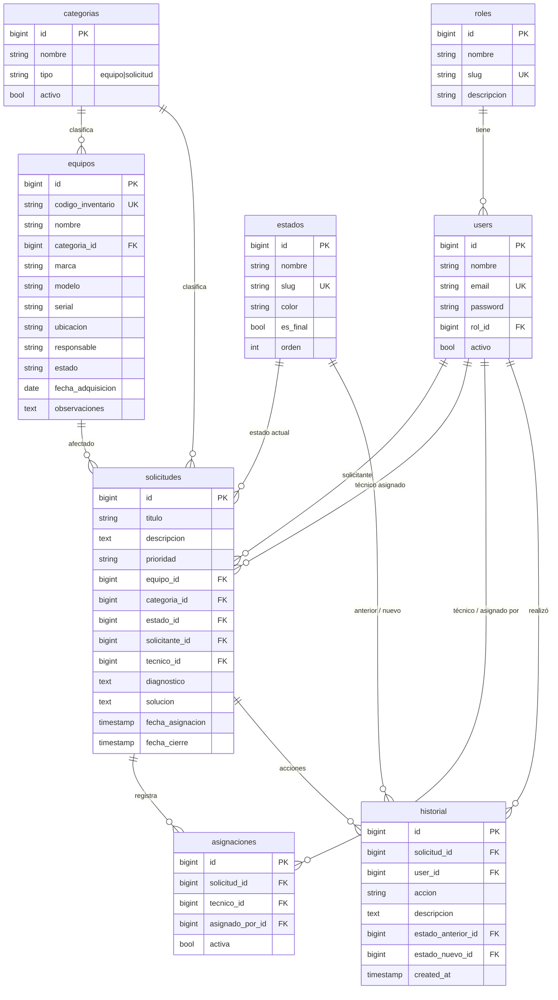

# Modelo de base de datos

Base de datos relacional con llaves foráneas. Funciona igual en SQLite (local), PostgreSQL y MySQL.

## Tablas

| Tabla | Para qué sirve |
|---|---|
| `roles` | admin, tecnico, usuario |
| `users` | Usuarios del sistema; cada uno con un rol. `activo = false` impide iniciar sesión |
| `categorias` | Una sola tabla para categorías de equipos y de solicitudes (columna `tipo`) |
| `estados` | Estados de las solicitudes. `es_final = true` (cerrada, cancelada) fija la fecha de cierre |
| `equipos` | Inventario tecnológico. `codigo_inventario` es único |
| `solicitudes` | Solicitudes de soporte con su técnico actual, diagnóstico y solución |
| `asignaciones` | Cada asignación o reasignación de técnico (la vigente tiene `activa = true`) |
| `historial` | Historial de atención: una fila por acción (creada, asignada, diagnóstico, cambio de estado, comentario) |
| `personal_access_tokens` | Tokens de Sanctum (sesiones de la app) |

## Reglas de integridad

- No se puede borrar un equipo, categoría, estado o usuario que tenga solicitudes (la API responde 409 y sugiere darlo de baja o desactivarlo).
- Al borrar una solicitud se borran sus asignaciones e historial (`cascade`).
- Las solicitudes solo aceptan categorías de tipo `solicitud` y equipos que no estén dados de baja; los equipos solo aceptan categorías de tipo `equipo`.
