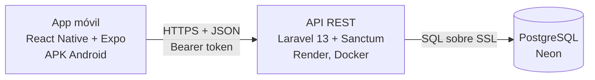
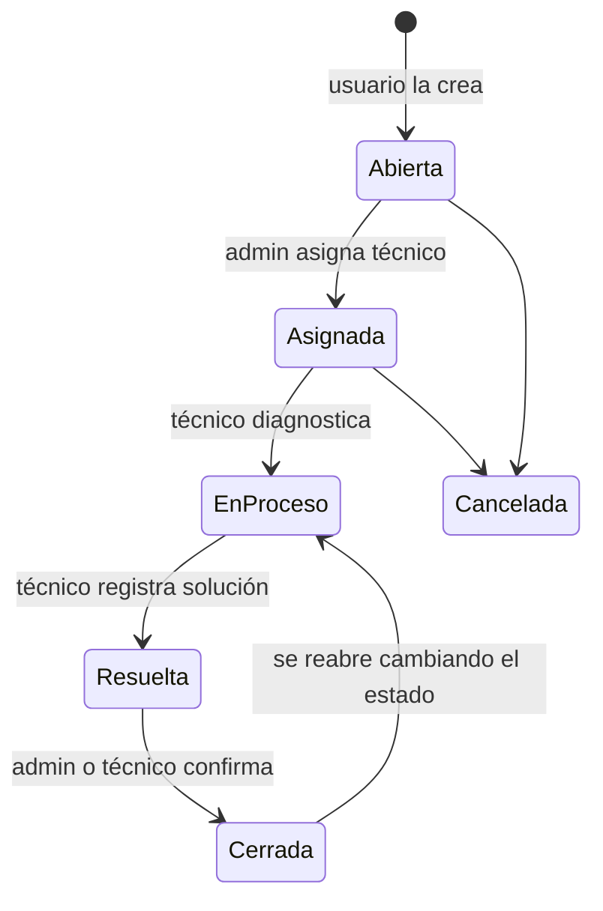

# Manual técnico

Sistema de gestión de soporte técnico e inventario tecnológico para Galaxia Seguridad.
Este manual describe cómo está construido el sistema: arquitectura, tecnologías, estructura del código, base de datos, seguridad y reglas de negocio.

Documentos relacionados: [Manual de instalación](MANUAL_INSTALACION.md) · [Documentación de la API](API.md) · [Base de datos y diagrama ER](BASE_DE_DATOS.md) · [Despliegue](DESPLIEGUE.md).

## 1. Arquitectura

El sistema tiene tres capas que se comunican por HTTPS con JSON:



| Capa | Tecnología | Responsabilidad |
|---|---|---|
| Presentación | React Native 0.88, Expo SDK 58, Expo Router, TypeScript | Pantallas, formularios, validación previa, navegación y guardar el token de sesión |
| Lógica de negocio | Laravel 13 (PHP 8.3), Laravel Sanctum 4 | Autenticación, permisos por rol, validaciones, reglas del flujo de solicitudes, historial |
| Datos | PostgreSQL (producción), SQLite (desarrollo local) | Persistencia relacional con llaves foráneas |

Principios de diseño:

- **La API es la única fuente de verdad.** La app oculta botones según el rol, pero quien hace cumplir los permisos es el backend. Si alguien llama la API directamente sin permiso recibe 403.
- **Contrato primero.** Antes de programar se escribió el contrato [`API_CONTRACT.md`](../app-movil/docs/API_CONTRACT.md); la app y el backend lo siguen.
- **Errores uniformes.** Todo error de la API es JSON con `message` (y `errors` por campo en 422), así la app muestra cada error debajo de su campo.

## 2. Estructura del repositorio

```
prueba-tecnica-galaxia-seguridad/
├── app-movil/          App React Native (Expo)
├── backend/            API REST Laravel
├── mock-api/           API simulada en Node (solo se usó para desarrollar la app al inicio)
├── docs/               Manuales, API, base de datos, despliegue y evidencias
└── render.yaml         Configuración del despliegue en Render
```

## 3. Backend (Laravel)

### 3.1 Patrón

Laravel sigue el patrón **MVC**. En una API no hay vistas HTML: la "vista" es el JSON que arman los **API Resources**.

Una petición recorre este camino:

```
routes/api.php  →  middleware (auth:sanctum, rol:...)  →  FormRequest (validación)
      →  Controller  →  Model (Eloquent)  →  Base de datos
      →  Resource (JSON)  →  respuesta
```

### 3.2 Carpetas principales

| Carpeta / archivo | Contenido |
|---|---|
| `routes/api.php` | Todas las rutas y qué rol puede usar cada una |
| `app/Http/Controllers/Api/` | `AuthController`, `PanelController`, `EquipoController`, `SolicitudController`, `UsuarioController`, `CategoriaController`, `EstadoController`, `CatalogoController` |
| `app/Http/Requests/` | Reglas de validación de equipos, solicitudes y usuarios |
| `app/Http/Resources/` | Forma del JSON de cada entidad |
| `app/Http/Middleware/VerificarRol.php` | Middleware `rol:admin,tecnico` para permisos |
| `app/Models/` | Modelos Eloquent y sus relaciones: `User`, `Rol`, `Equipo`, `Categoria`, `Estado`, `Solicitud`, `Asignacion`, `Historial` |
| `database/migrations/` | Creación de tablas, índices y llaves foráneas |
| `database/seeders/` | Roles, categorías, estados, usuarios de prueba, 23 equipos y 5 solicitudes de ejemplo |
| `bootstrap/app.php` | Registro del middleware de rol y manejo centralizado de errores en JSON |
| `lang/es/` | Mensajes de validación en español |
| `tests/Feature/ApiTest.php` | 13 pruebas automáticas de la API |
| `Dockerfile`, `docker/start.sh` | Imagen de producción y arranque del contenedor |

### 3.3 Autenticación

- Se usa **Laravel Sanctum** con tokens personales (API tokens).
- `POST /api/login` valida correo y contraseña (guardada con hash bcrypt), revisa que el usuario esté activo y crea un token con `createToken()`. El token se guarda en la tabla `personal_access_tokens` (solo su hash).
- La app envía el token en cada petición: `Authorization: Bearer <token>`. El middleware `auth:sanctum` identifica al usuario.
- `POST /api/logout` borra el token actual. Desactivar un usuario borra todos sus tokens.
- El login tiene límite de 10 intentos por minuto (`throttle:10,1`) contra ataques de fuerza bruta.

### 3.4 Autorización por roles

| Rol (`slug`) | Puede |
|---|---|
| `admin` | Todo: ver todas las solicitudes, asignar técnicos, crear/editar/eliminar equipos, diagnosticar, cambiar estado, administrar usuarios, categorías y estados |
| `tecnico` | Registrar y editar equipos; ver las solicitudes asignadas a él y las que creó; diagnosticar y cambiar estado de las asignadas a él |
| `usuario` | Consultar equipos, inventario e historial; crear solicitudes y ver solo las propias |

Se aplica en dos niveles:

1. **Ruta**: middleware `rol:` en `routes/api.php` (por ejemplo `->middleware('rol:admin')` en asignar).
2. **Registro**: dentro del controlador. `Solicitud::visiblesPara($user)` filtra qué solicitudes ve cada rol, y `autorizarAtender()` comprueba que un técnico sea el asignado antes de diagnosticar.

### 3.5 Validaciones y manejo de errores

- Validaciones con **FormRequest** (`EquipoRequest`, `SolicitudRequest`, `UsuarioRequest`) y `$request->validate()` en acciones pequeñas. Ejemplos: código de inventario único, categoría del tipo correcto, fecha de adquisición no futura, título de 5 a 150 caracteres, descripción mínima de 10, prioridad en `baja|media|alta|critica`, técnico activo con rol técnico.
- `bootstrap/app.php` convierte toda excepción en JSON: 401, 403, 404 con el nombre del recurso ("El equipo no existe."), 405, 409 (llave foránea o duplicado), 422, 429 y 500 sin detalles internos en producción.
- Las operaciones que tocan varias tablas (crear solicitud + historial, asignar + asignación + historial) se hacen dentro de `DB::transaction` para que no queden datos a medias.

### 3.6 Reglas del flujo de una solicitud



- Al crear: estado `abierta` y una fila `creada` en el historial.
- Al asignar: si estaba `abierta` pasa a `asignada`; se guarda `fecha_asignacion` y una fila en `asignaciones`. Reasignar desactiva la asignación anterior (queda el registro).
- Al pasar a un estado final (`cerrada`, `cancelada`) se guarda `fecha_cierre`; si se reabre, se borra.
- Una solicitud finalizada no acepta diagnóstico ni asignación hasta que se reabra.
- Cada acción (creada, asignada, diagnóstico, cambio de estado, comentario) deja una fila en `historial` con quién la hizo, cuándo y el estado anterior y nuevo.

### 3.7 Pruebas automáticas

`php artisan test` ejecuta 13 pruebas de integración sobre una base de datos en memoria: login correcto e incorrecto, acceso sin token, catálogos, paginación y búsqueda de equipos, código único, permisos por rol, borrado con 409, flujo completo de una solicitud (crear, asignar, diagnosticar, resolver, cerrar, reabrir), visibilidad por rol, validaciones, inventario y administración de usuarios.

## 4. App móvil (React Native + Expo)

### 4.1 Estructura

```
app-movil/src/
├── app/                    Pantallas. Cada archivo es una ruta (Expo Router)
│   ├── _layout.tsx         Navegación raíz y protección: sin sesión solo se ve el login
│   ├── login.tsx
│   ├── (tabs)/             Pestañas: Panel, Equipos, Solicitudes, Inventario, Historial
│   ├── equipo/[id].tsx     Detalle de un equipo
│   ├── equipo/form.tsx     Crear y editar equipo
│   ├── solicitud/[id].tsx  Detalle: asignar, diagnosticar, cambiar estado, historial
│   └── solicitud/nueva.tsx Nueva solicitud
├── api/
│   ├── client.ts           fetch con token, tiempo límite de 60 s y errores normalizados (ApiError)
│   ├── endpoints.ts        Una función por ruta de la API
│   └── types.ts            Tipos TypeScript de cada objeto del contrato
├── context/auth.tsx        Sesión: login, logout, restaurar sesión, hasRole()
├── components/             Botones, campos, tarjetas, insignias, ítems de lista
├── utils/                  useApi y usePaginated (carga de datos), formato de fechas y estados
└── theme.ts                Colores (rojo y negro de Galaxia) y espaciados
```

### 4.2 Funcionamiento

- **Navegación**: Expo Router usa las carpetas como rutas. `Stack.Protected` en `_layout.tsx` muestra el login si no hay usuario y las pestañas si lo hay.
- **Sesión**: `AuthProvider` (React Context) guarda el usuario. El token se guarda cifrado en el teléfono con **expo-secure-store**. Al abrir la app se valida con `GET /me`; si responde 401 se cierra la sesión.
- **Datos**: los hooks `useApi` y `usePaginated` llaman la API, manejan carga, error, "jalar para refrescar" y paginación infinita, y recargan al volver a una pantalla.
- **Errores**: `client.ts` convierte cada respuesta de error en `ApiError`. Los formularios muestran los errores 422 debajo de cada campo.
- **URL de la API**: variable `EXPO_PUBLIC_API_URL` (archivo `.env` o perfil de EAS). El APK usa `https://galaxia-soporte-api.onrender.com/api`. La URL activa se ve al pie del login.

### 4.3 Requisitos de la prueba y dónde están

| Requisito | Pantalla |
|---|---|
| Inicio de sesión | `login.tsx` |
| Panel principal | `(tabs)/index.tsx` |
| Registro y consulta de equipos | `(tabs)/equipos.tsx`, `equipo/[id].tsx`, `equipo/form.tsx` |
| Inventario tecnológico | `(tabs)/inventario.tsx` |
| Creación de solicitudes | `solicitud/nueva.tsx` |
| Consulta del estado de solicitudes | `(tabs)/solicitudes.tsx`, `solicitud/[id].tsx` |
| Asignación de técnicos | `solicitud/[id].tsx` (administrador) |
| Diagnósticos y soluciones | `solicitud/[id].tsx` (técnico asignado o administrador) |
| Historial de atención | `(tabs)/historial.tsx` y línea de tiempo en cada solicitud |

## 5. Base de datos

Modelo relacional de 8 tablas de negocio más la de tokens. Diagrama entidad-relación, descripción de cada tabla y reglas de integridad en [BASE_DE_DATOS.md](BASE_DE_DATOS.md).

Requisitos de la prueba cubiertos: usuarios (`users`), roles (`roles`), equipos (`equipos`), solicitudes (`solicitudes`), categorías (`categorias`), asignaciones (`asignaciones`) e historial de atención (`historial`). Además `estados` para los estados de las solicitudes.

## 6. Despliegue

Backend en Render (Docker), base de datos PostgreSQL en Neon y APK generado con Expo EAS. Todo el detalle está en [DESPLIEGUE.md](DESPLIEGUE.md).

## 7. Seguridad

- Contraseñas con hash bcrypt (nunca en texto plano). El campo `password` está oculto en el JSON.
- Tokens Sanctum; en la base solo se guarda el hash del token. En el teléfono el token va en almacenamiento seguro.
- HTTPS en producción (Render) y SSL obligatorio hacia la base de datos (`DB_SSLMODE=require`).
- Permisos verificados en el servidor en cada petición.
- Límite de intentos de login.
- `APP_DEBUG=false` en producción: los errores 500 no muestran detalles internos.
- Secretos (cadena de conexión de Neon, `APP_KEY`) solo en las variables de entorno de Render, nunca en el repositorio.
- Consultas con Eloquent y parámetros enlazados (`?`), lo que evita inyección SQL.

## 8. Limitaciones conocidas y mejoras futuras

- El plan gratuito de Render duerme el servidor tras 15 minutos: la primera petición tarda hasta un minuto.
- La administración de usuarios, categorías y estados existe en la API (rutas de administrador) pero aún no tiene pantallas en la app.
- Mejoras posibles: notificaciones push al asignar, adjuntar fotos de la falla, reportes en PDF, código QR en cada equipo.
