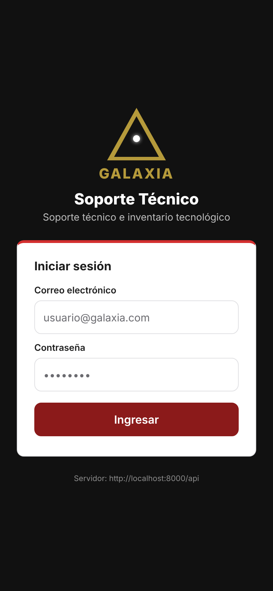
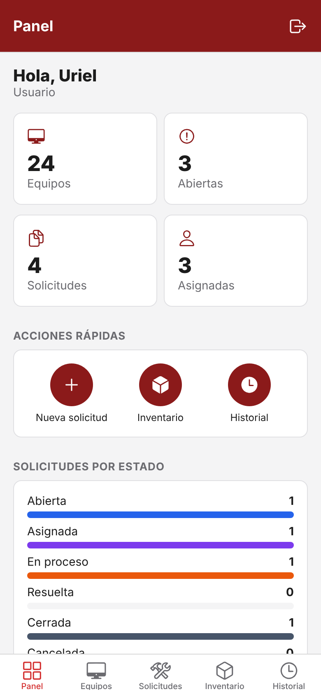
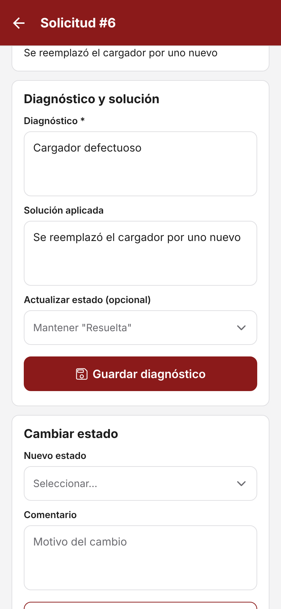
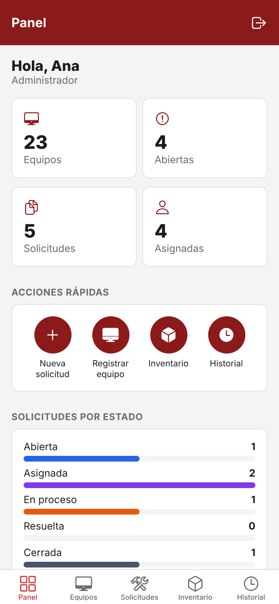

# Manual de usuario

**Galaxia Soporte** es la app para reportar fallas de equipos de cómputo, hacer seguimiento a cada solicitud de soporte y consultar el inventario tecnológico de la empresa.

Hay tres tipos de usuario. Cada uno ve las mismas pestañas, pero con opciones distintas:

| Rol | Qué hace en la app |
|---|---|
| **Usuario** | Reporta fallas y sigue el estado de sus solicitudes. Consulta equipos e inventario. |
| **Técnico** | Registra equipos y atiende las solicitudes que le asignan: diagnóstico, solución y cambio de estado. |
| **Administrador** | Ve todo, asigna técnicos, edita y elimina equipos y puede atender cualquier solicitud. |

Cuentas de prueba (contraseña `password`): `usuario@galaxia.com`, `tecnico@galaxia.com`, `tecnico2@galaxia.com`, `admin@galaxia.com`.

---

## 1. Funciones comunes a todos

### 1.1 Iniciar y cerrar sesión

1. Abrir la app **Galaxia Soporte**.
2. Escribir el correo y la contraseña y pulsar **Ingresar**.
3. Si falta un dato o el correo no es válido, el error aparece debajo del campo. Si la clave es incorrecta aparece "Las credenciales no son válidas."
4. La sesión queda guardada: al volver a abrir la app no hay que ingresar de nuevo.
5. Para salir, pulsar el ícono de **salida** arriba a la derecha del Panel.

> La primera vez del día el servidor puede tardar hasta un minuto en responder (está "despertando"). Si aparece un aviso, reintentar.

### 1.2 Panel

Es la pantalla de inicio. Muestra:

- Saludo con el nombre y el rol.
- Tarjetas con **Equipos**, solicitudes **Abiertas**, total de **Solicitudes** y **Asignadas** (para el técnico, "Asignadas a mí"). Al tocar una tarjeta se abre la lista correspondiente.
- **Acciones rápidas**: Nueva solicitud, Registrar equipo (solo técnico y administrador), Inventario e Historial.
- **Solicitudes por estado** con barras de colores, y las solicitudes más recientes.

Los números cuentan solo lo que cada persona puede ver.

### 1.3 Pestañas

En la parte inferior hay cinco pestañas: **Panel**, **Equipos**, **Solicitudes**, **Inventario** e **Historial**. En todas las listas se puede **deslizar hacia abajo** para actualizar, y al llegar al final se cargan más resultados.

### 1.4 Consultar equipos

1. Pestaña **Equipos**.
2. Buscar por código, nombre, serial, marca, modelo o ubicación en la barra superior.
3. Filtrar por estado con los botones: Operativo, En mantenimiento, Dado de baja.
4. Tocar un equipo para ver su ficha: código de inventario, categoría, marca, modelo, serial, ubicación, responsable, fecha de adquisición, observaciones y sus solicitudes.

### 1.5 Reportar una falla (crear una solicitud)

1. Pulsar **Nueva solicitud** (en el Panel o con el botón **+** de la pestaña Solicitudes), o desde la ficha de un equipo pulsar **Reportar falla de este equipo** (el equipo queda elegido).
2. Completar:
   - **Equipo afectado**.
   - **Tipo de problema**: Hardware, Software, Red e internet, Impresión, Correo y cuentas o Mantenimiento preventivo.
   - **Prioridad**: Baja, Media, Alta o Crítica.
   - **Asunto** (5 a 150 caracteres).
   - **Descripción** de la falla (mínimo 10 caracteres).
3. Pulsar **Enviar solicitud**. Queda en estado **Abierta** y se abre su detalle.

No se pueden crear solicitudes sobre equipos dados de baja.

### 1.6 Seguir una solicitud

1. Pestaña **Solicitudes**. Se puede buscar por número, título o código del equipo y filtrar por estado.
2. Tocar una solicitud para ver su detalle: estado, prioridad, equipo, tipo, solicitante, técnico, fechas de creación, asignación y cierre, diagnóstico, solución e **historial de atención** (línea de tiempo con cada acción, quién la hizo y cuándo).
3. Los comentarios que el técnico o el administrador escriben al cambiar el estado también aparecen en el historial.

Estados posibles:

| Estado | Significa |
|---|---|
| Abierta | Recién creada, sin técnico |
| Asignada | Ya tiene técnico |
| En proceso | El técnico está trabajando en ella |
| Resuelta | El técnico aplicó una solución |
| Cerrada | Confirmada y finalizada |
| Cancelada | Anulada |

### 1.7 Inventario

Pestaña **Inventario**: total de equipos y conteos por estado, por categoría (escritorio, portátil, impresora, red, servidor, periférico) y por ubicación.

### 1.8 Historial

Pestaña **Historial**: todas las acciones registradas sobre las solicitudes que la persona puede ver, de la más reciente a la más antigua. Tocar una acción abre su solicitud.

---

## 2. Rol Usuario

El usuario **reporta fallas y hace seguimiento**.

- Ve solo **sus propias** solicitudes.
- En la ficha de un equipo no aparecen los botones Editar ni Eliminar.
- En el detalle de una solicitud no aparecen las secciones de asignar, diagnosticar ni cambiar estado.

Flujo típico: Panel → Nueva solicitud → completar el formulario → revisar más tarde en Solicitudes cómo avanza.

---

## 3. Rol Técnico

El técnico **atiende las solicitudes que le asignan** y mantiene el inventario.

### 3.1 Ver lo asignado
- En el Panel, la tarjeta **Asignadas a mí**.
- En Solicitudes, activar **Solo asignadas a mí**.
- Ve las solicitudes asignadas a él y las que él mismo creó.

### 3.2 Registrar diagnóstico y solución
En el detalle de una solicitud asignada a él:
1. Sección **Diagnóstico y solución**: escribir el **Diagnóstico** (obligatorio, causa encontrada) y la **Solución aplicada**.
2. Opcional: en **Actualizar estado** elegir, por ejemplo, En proceso o Resuelta.
3. Pulsar **Guardar diagnóstico**. Queda en el historial.

### 3.3 Cambiar el estado
Sección **Cambiar estado**: elegir el nuevo estado, escribir un comentario (motivo) y pulsar **Actualizar estado**.
Al pasar a **Cerrada** o **Cancelada** se registra la fecha de cierre. Una solicitud cerrada no admite diagnóstico; para reabrirla se le cambia el estado.

### 3.4 Registrar y editar equipos
1. Pestaña Equipos → botón **Registrar equipo** (o desde el Panel).
2. Completar código de inventario (único), nombre, categoría y estado (obligatorios) y opcionalmente marca, modelo, serial, ubicación, responsable, fecha de adquisición y observaciones.
3. Pulsar **Registrar equipo**. Si el código ya existe aparece "Ya existe un equipo con este código de inventario."
4. Para editar, abrir la ficha del equipo, pulsar **Editar equipo** y luego **Guardar cambios**.

El técnico no puede eliminar equipos ni asignar solicitudes.

---

## 4. Rol Administrador

El administrador **coordina** el soporte.

### 4.1 Asignar o reasignar un técnico
1. Abrir una solicitud (ve todas).
2. Sección **Asignar técnico**: elegir el técnico y pulsar **Asignar**.
3. Si estaba Abierta pasa a **Asignada**. Si ya tenía técnico, se reasigna y queda registrado en el historial.

### 4.2 Atender cualquier solicitud
Puede registrar diagnóstico y cambiar el estado de cualquier solicitud, igual que el técnico.

### 4.3 Gestionar equipos
Registrar, editar y **eliminar** equipos. Un equipo con solicitudes no se puede eliminar (aparece un aviso); en ese caso se cambia su estado a **Dado de baja**.

### 4.4 Usuarios, categorías y estados
La API ofrece al administrador la gestión de usuarios (crear, editar, desactivar), categorías y estados (rutas `/usuarios`, `/categorias`, `/estados` en [API.md](API.md)). En esta versión se usan desde la API (por ejemplo con PowerShell o Postman); la app aún no tiene pantallas para ello.

---

## 5. Mensajes frecuentes

| Mensaje | Qué hacer |
|---|---|
| "No se pudo conectar con el servidor" | Revisar la conexión a internet. |
| "El servidor tardó demasiado en responder" | El servidor estaba dormido; esperar unos segundos y reintentar. |
| "Tu sesión expiró" | Iniciar sesión de nuevo. |
| "No tienes permiso para realizar esta acción" | La acción no corresponde a tu rol. |
| "Tu usuario está inactivo" | Pedir al administrador que lo active. |
